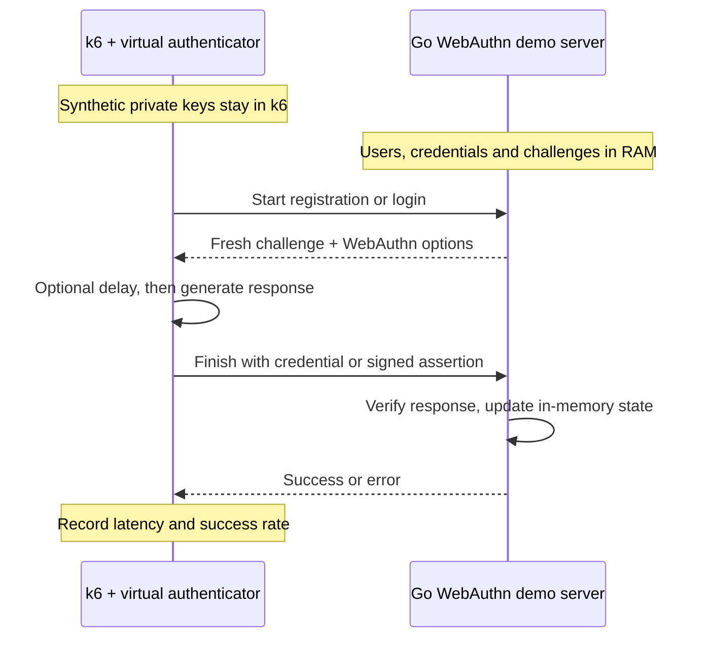

# xk6-passkeys

A [k6](https://grafana.com/docs/k6/latest/) extension for load-testing WebAuthn registration and login backends using virtual credentials and real cryptographic responses. No browser or physical authenticator is required.

See the [passkey performance-testing walkthrough](https://www.corbado.com/blog/passkey-performance-testing).

## What this measures

The examples exercise challenge generation and response verification over HTTP. They include network time and client-side response generation. They do not measure biometric/PIN interaction, browser UI, passkey-provider synchronization, or real-device compatibility. The extension models an ES256 credential with user presence/verification and backup flags set, and an Apple iCloud Keychain AAGUID; this is synthetic metadata and does not represent an Apple device or an attestation of one.

Test registration and login independently. Neither one's capacity proves the other's.

## How the demo works



Both processes run locally in the quickstart; the Go server runs in Docker. The server
stores public credentials and pending challenges in Go maps, with no database. Restarting
it clears that state. Registration creates the credential; login reuses it with a fresh
challenge. k6 measures the HTTP flow, while the virtual authenticator runs inside k6.

## Build and run

Install Go **1.26 or newer**, Git and Make. Docker is needed only for the containerized demo backend.

The build pins **k6 v1.8.1**, **xk6 v1.4.13** and **virtualwebauthn v1.0.5**. The demo uses **go-webauthn v0.18.2** and **Gin v1.12.0**. k6's version comes from `go.mod`; xk6's comes from `Makefile`.

```bash
git clone https://github.com/corbado/xk6-passkeys
cd xk6-passkeys
make build
./k6 version
docker build -t passkeys-backend examples/backend
docker run --rm -p 127.0.0.1:8080:8080 passkeys-backend
```

Leave the backend running. In another terminal:

```bash
./k6 run examples/registration.js
./k6 run examples/login.js
```

Both default to two virtual users for 30 seconds. Login setup registers a pool of users before the timed workload. Each VU reuses one identity; by default the pool covers all configured VUs.

Without Docker, run `go run .` from `examples/backend`.

**The backend is a disposable test fixture and must never be used as an authentication service.** It stores users and challenges in memory, has no persistent database or application sessions, and has no cleanup of users or abandoned challenges. Restart it between runs. Keep it local; do not use real user data or production credentials.

## Configure the workload

Use environment variables via `-e`. The examples configure explicit scenarios, so k6's `--vus`/`--duration` shortcuts do not apply.

| Variable | Default | Purpose |
| --- | --- | --- |
| `BASE_URL` | `http://localhost:8080` | Backend HTTP address |
| `RP_ID` | `localhost` | WebAuthn relying-party ID |
| `ORIGIN` | `http://localhost:8080` | Origin accepted by the relying party |
| `VUS` | `2` | Concurrent VUs in the default closed workload |
| `DURATION` | `30s` | Timed workload duration |
| `RATE` | unset | Switch to a constant arrival rate, in ceremonies/second |
| `PRE_ALLOCATED_VUS` | `VUS` | VUs initially allocated for arrival-rate mode |
| `MAX_VUS` | `PRE_ALLOCATED_VUS` | Maximum VUs in arrival-rate mode |
| `USER_COUNT` | `VUS` or `MAX_VUS` | Login setup identities; a smaller pool shares identities |
| `THINK_TIME` | `0` | Seconds between challenge and response; also applies to setup |
| `CEREMONY_P95_MS` | `1000` | Example p95 limit, including configured think time |
| `SETUP_TIMEOUT` | `2m` | Allow more time for larger login pools |

A modest fixed-arrival-rate example:

```bash
./k6 run -e RATE=20 -e PRE_ALLOCATED_VUS=10 -e MAX_VUS=40 \
  -e DURATION=30s examples/login.js
```

To model time spent interacting with an authenticator:

```bash
./k6 run -e RATE=5 -e PRE_ALLOCATED_VUS=20 -e MAX_VUS=30 \
  -e THINK_TIME=2 -e CEREMONY_P95_MS=4000 examples/login.js
```

This is a fixed synthetic delay and does not come from any measured biometric interaction. A delay increases in-flight ceremonies and challenge lifetime pressure. Budget VUs for arrival rate × ceremony duration, plus headroom. Investigate `dropped_iterations`: missed starts mean the requested load was not delivered. Monitor load-generator CPU and memory as well as the server.

Use observed peak ceremony rates and an agreed headroom target when sizing a staging test. Increase load in steps. The examples' defaults are only a starting point and no capacity recommendation.

## Results and CI

- `ceremony_success`: completed ceremonies / attempted ceremonies, including script exceptions as failures.
- `ceremony_duration`: time for both HTTP calls, virtual-authenticator work and any think time, including failed attempts.
- `http_req_duration`: per-request latency. Full ceremony latency is `ceremony_duration`. Stable `name` tags distinguish registration/login start and finish.
- `http_req_failed`: HTTP failure rate.
- `dropped_iterations`: arrivals that could not start (arrival-rate mode).

The examples set thresholds for success rate (>99%), HTTP failure rate (<1%), ceremony p95 (<1,000 ms by default), and zero dropped arrivals. These are illustrative limits; select your own SLOs. Failed thresholds return a nonzero exit code. Checks alone do not make a k6 run fail.

```bash
./k6 run --summary-export=summary.json examples/login.js
```

Login's setup registration contributes to built-in HTTP metrics, but not the custom ceremony metrics. Use scenario/name filters in time-series outputs to separate setup traffic. Store the configuration, versions, duration, achieved rate, percentiles and failures alongside results. Local in-memory measurements are not evidence of production capacity.

## Adapt to an existing backend

Changing `BASE_URL` is sufficient only if your server implements the demo contract. Edit `examples/ceremony.js` to map your own endpoints, HTTP methods, cookies/tokens, CSRF requirements, challenge envelopes and finish payloads.

| Demo endpoint | Response / request |
| --- | --- |
| `GET /register/start/:username` | JSON `publicKey` creation options |
| `POST /register/finish/:username` | Generated credential JSON |
| `GET /login/start/:username` | JSON `publicKey` request options |
| `POST /login/finish/:username` | Generated assertion JSON |

Preserve each ceremony's challenge and session context; obtain a fresh challenge each iteration. Include gateways, adapters, identity providers and database work in the path whose capacity you want to measure. A direct test of only the WebAuthn verification service excludes those other components.

The demo uses UTF-8 username bytes as the WebAuthn user handle. Other servers may issue opaque binary user IDs: preserve the original bytes and adapt the extension boundary if they cannot be represented as UTF-8. Do not pass an encoded ID as if it were the decoded user handle.

The pool is copied to each VU by k6, so large pools increase memory and setup cost. Distributed generators need a suitable identity partitioning strategy. Credential fixtures contain private keys: use synthetic users and keep fixtures out of source control and logs.

## JavaScript API

```js
import passkeys from 'k6/x/passkeys';

const rp = passkeys.newRelyingParty('Example', 'example.com', 'https://example.com');
const credential = passkeys.newCredential();
const attestation = passkeys.createAttestationResponse(rp, credential, creationOptionsJSON);
const assertion = passkeys.createAssertionResponse(rp, credential, userHandle, requestOptionsJSON);
```

Options are JSON strings with a `publicKey` envelope. Responses are JSON strings ready for the demo's finish endpoints. Malformed options surface as JavaScript errors. Explicitly serialize credentials with `JSON.stringify` when transferring them through k6 `setup()` and parse them in the VU.

## Development

```bash
make test
make build
bash scripts/smoke-test.sh
cd examples && npm ci && npm run lint
```

CI builds the custom binary, tests both Go modules and runs registration/login smoke tests. Use real browser/device tests separately for user experience and interoperability.
